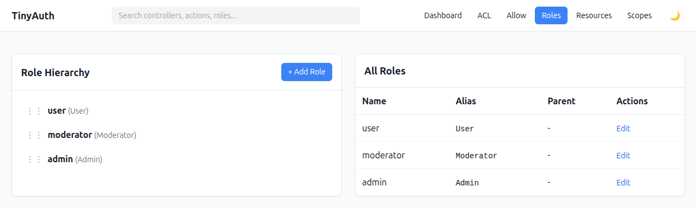

# Roles

The roles section manages aliases, ordering, and optional hierarchy.



## Role fields

| Field | Meaning |
|-------|---------|
| `name` | Human-readable label |
| `alias` | Runtime role key used by permission checks |
| `sort_order` | Display/order hint |
| `parent_id` | Higher role that this role rolls up into |

## Hierarchy semantics

This plugin models hierarchy like this:

```text
admin
  └─ moderator
      └─ user
```

Meaning:

- `user.parent_id = moderator`
- `moderator.parent_id = admin`
- higher roles inherit lower-role permissions

So if `user` can `edit Article`, then `moderator` and `admin` also inherit that
permission unless they have a direct rule of their own.

::: tip Direct rules win
A direct rule on the current role always wins over an inherited one.
:::

## External role sources

You do not have to manage roles in `tinyauth_roles`.

`TinyAuthBackend.roleSource` can be:

- `null`, use the plugin table
- a Configure path string
- an array of `alias => id`
- a callable returning that array

When an external source is used:

- the roles UI becomes read-only
- external roles are mirrored into `tinyauth_roles` so ACL / resource assignments
  can still be stored with foreign keys
- mirrored rows are kept in sync with the external source, and obsolete rows are
  pruned

### Example config

```php
'TinyAuthBackend' => [
    'roleSource' => [
        'user' => 1,
        'moderator' => 2,
        'admin' => 3,
    ],
],
```

### Role IDs must be integers

Whatever you put on the right-hand side of `alias => id` must be an integer or a
numeric string (e.g. `3` or `"3"`). The plugin stores permission rows keyed by an
integer `role_id` foreign key. Non-numeric values such as UUIDs or opaque slugs cannot be used as IDs directly.

Non-numeric IDs are dropped from the map and a warning is written to the
`default` log channel (`TinyAuthBackend.roleSource dropped N role(s) with
non-numeric ids: ...`) so you can spot a misconfigured source instead of
wondering why the permission matrix is empty.

### I already have UUID roles in my app

Common scenario: you have a pre-existing `Users` / `Roles` schema with UUID
primary keys, or you pull roles from an upstream IdP (Keycloak, Auth0, Cognito, a
SaaS-issued JWT) that uses opaque string IDs.

Use a persistent registry that assigns each role alias a unique integer. Return the complete application role catalog, including roles that the current user does not have:

```php
Configure::write('TinyAuthBackend.roleSource', [
    'user' => 1,
    'moderator' => 2,
    'admin' => 3,
]);
```

Keep these IDs stable across requests and deployments. Do not derive IDs with a hash: collisions can associate permissions with the wrong role.

The plugin mirrors this catalog into its roles table. Removing an alias from the catalog removes its shadow row and the permission rows linked to it. A callable must therefore return all roles, not the current user's role memberships. Your identity layer can retain UUIDs and translate memberships through the registry.

## See also

- [External Role Source strategy](/strategies/external-roles)
- [RoleSourceService](/reference/services#rolesourceservice)
